# Court analytics

58 US Open quarterfinals, semifinals and finals from broadcast video (2001–2025): 14 decoded and aligned to the Match Charting Project, 0 decoded without an MCP record, 44 with player positions only. 5,982 rally shots and 2,441 serves located; 15.4 h of rally time tracked. 103 of the 160 archived videos have not been processed yet. Generated 2026-10-13 by `scripts/analytics.py`.

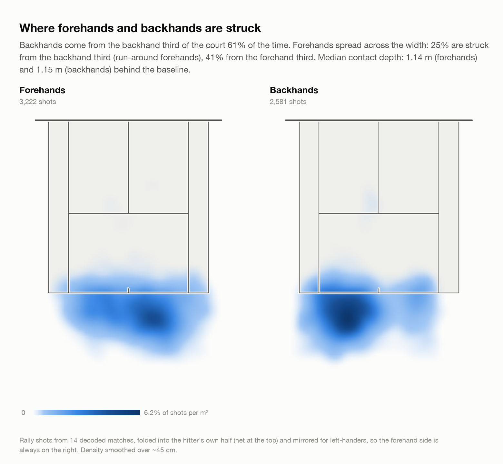

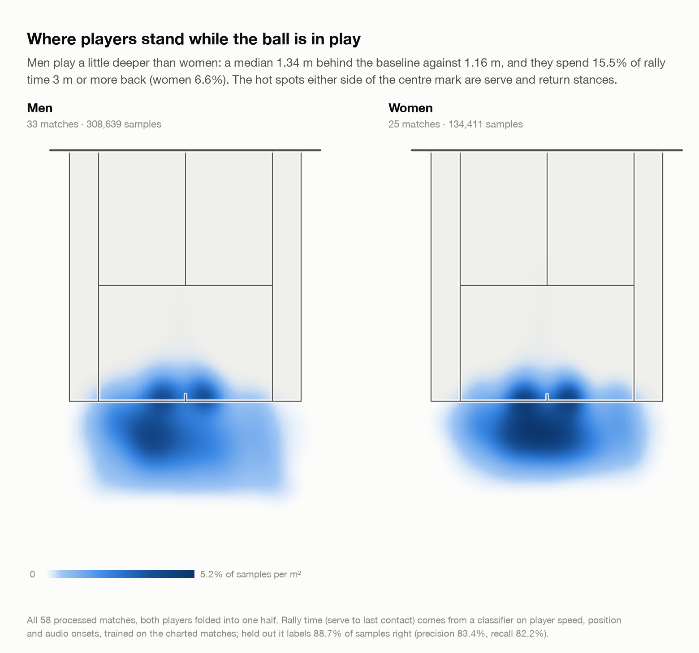

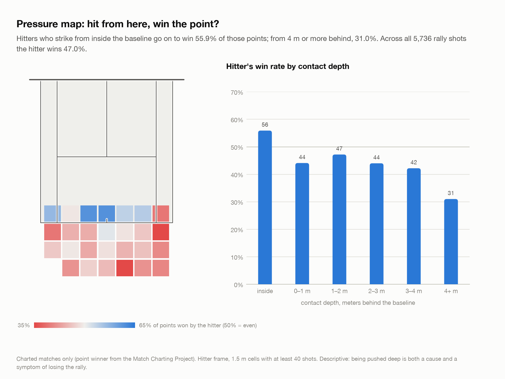

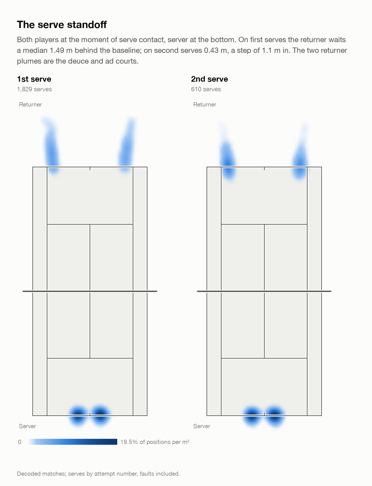

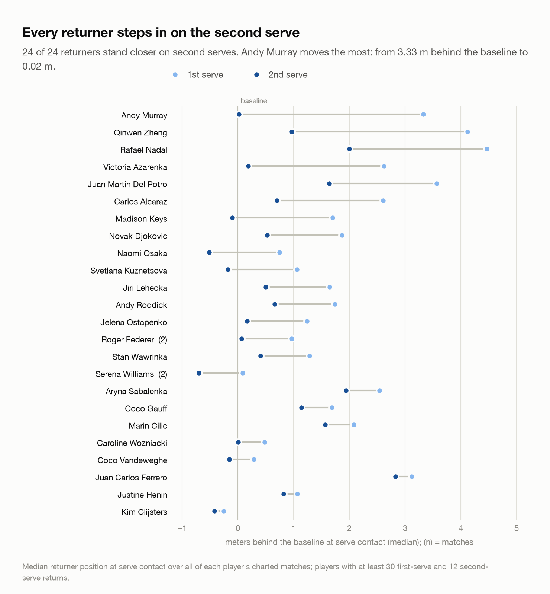

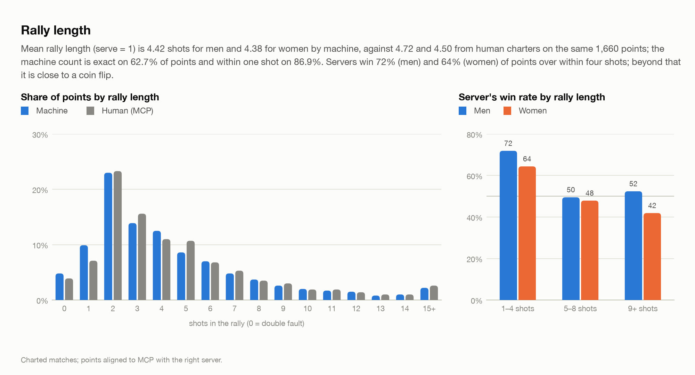

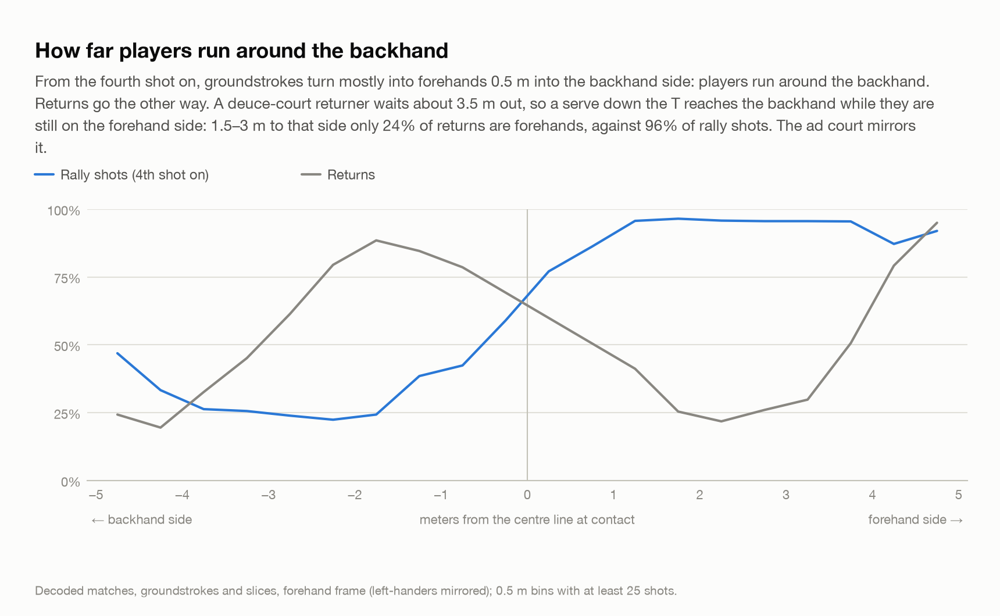

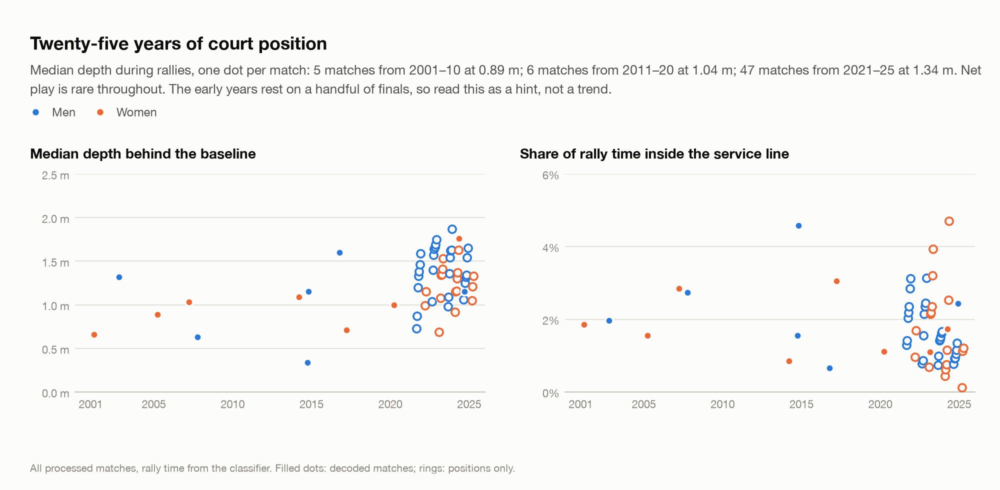

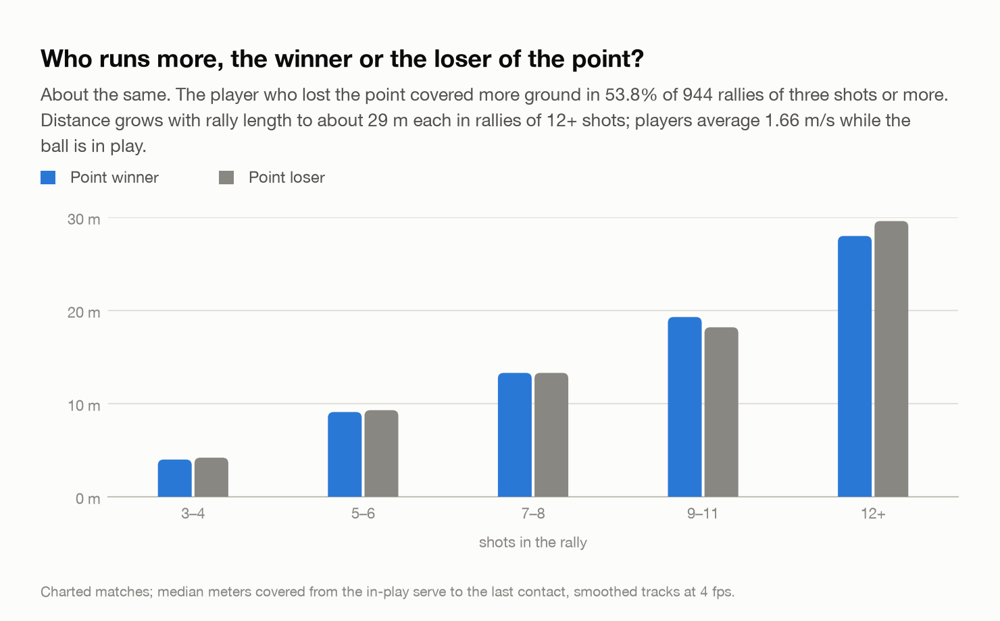

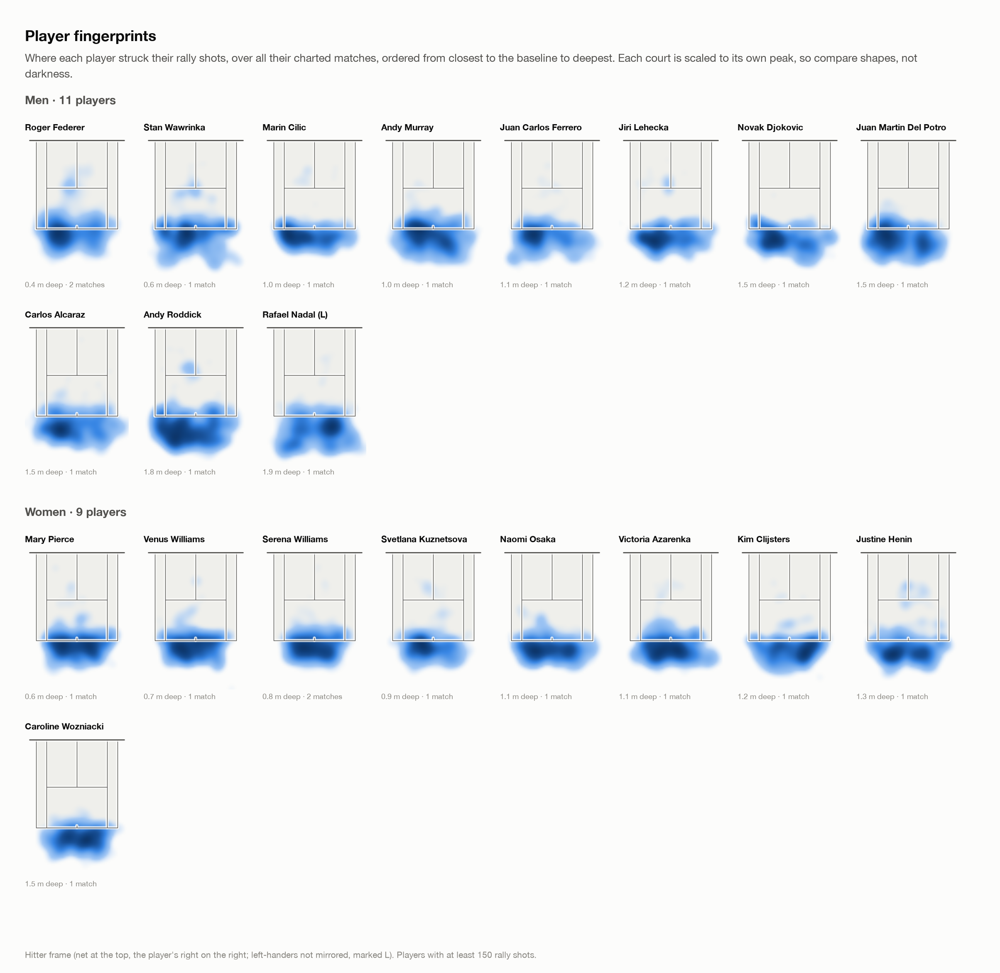

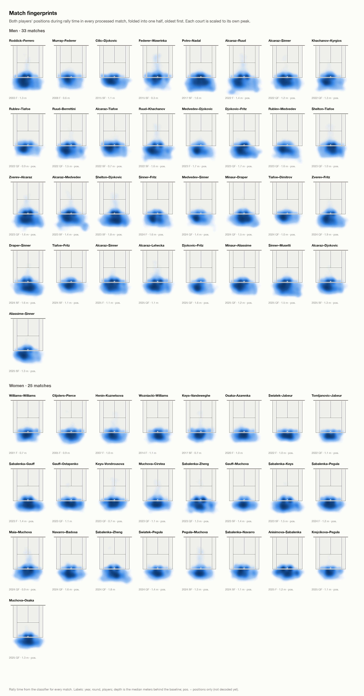

## Caveats

* Rally length from the machine is exact on about 63% of points and within one shot on 87% (held-out evaluation), and runs low on long rallies. Forehand/backhand is about 91% accurate; slices, volleys and touch shots are weak, so they are not broken out.
* Positions are each player's ground point from the tracker, in court meters: where the player stood, not where the ball was.
* Depth is calibrated at the baseline (servers read 0.03 m near, -0.14 m far) but the ends disagree behind it: first-serve returners read 1.89 m deep at the near end and 0.96 m at the far end, and the near player leaves the frame beyond about 4.5 m. Players change ends every other game, so comparisons between groups are like for like; treat absolute depths as roughly ±0.4 m.
* Point winners come from MCP through the point alignment; everything else is machine-made.

Tables: `per_match.csv`, `rallytime_eval.csv`, `rally_length_distribution.csv`, `server_win_by_rally.csv`, `return_depth_by_returner.csv`, `forehand_share_by_x.csv`, `win_by_depth.csv`, `distance_by_rally.csv`, `serve_setup.csv`, `players.csv`, `zones_forehand.csv`, `zones_backhand.csv`, `zones_rally_time_men.csv`, `zones_rally_time_women.csv`.

Regenerate: `cd charting && uv run python scripts/analytics.py [--sync] [--refit]`.
